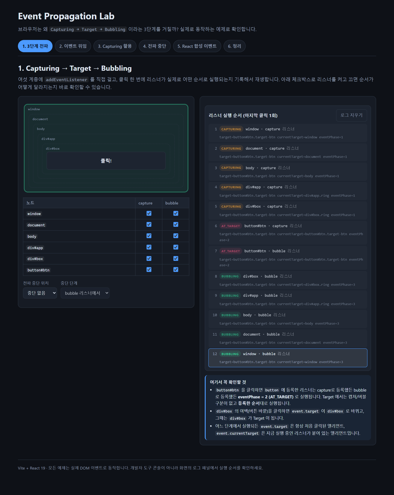
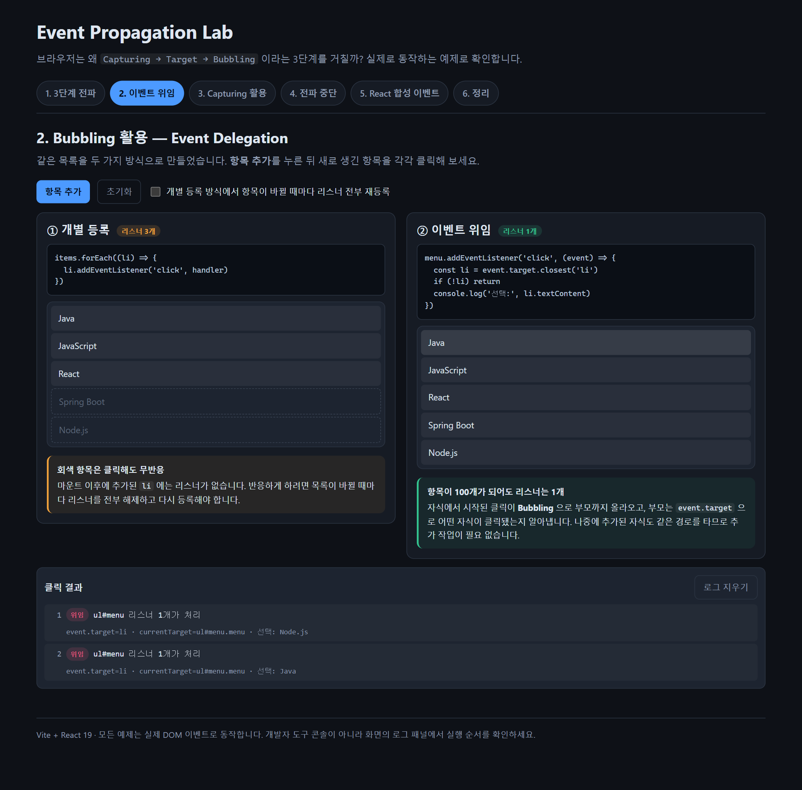
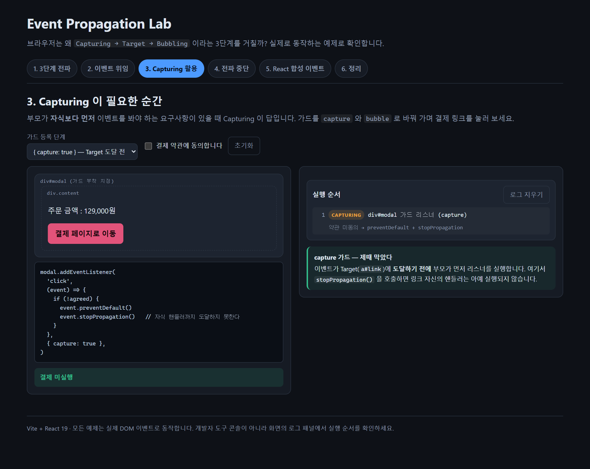
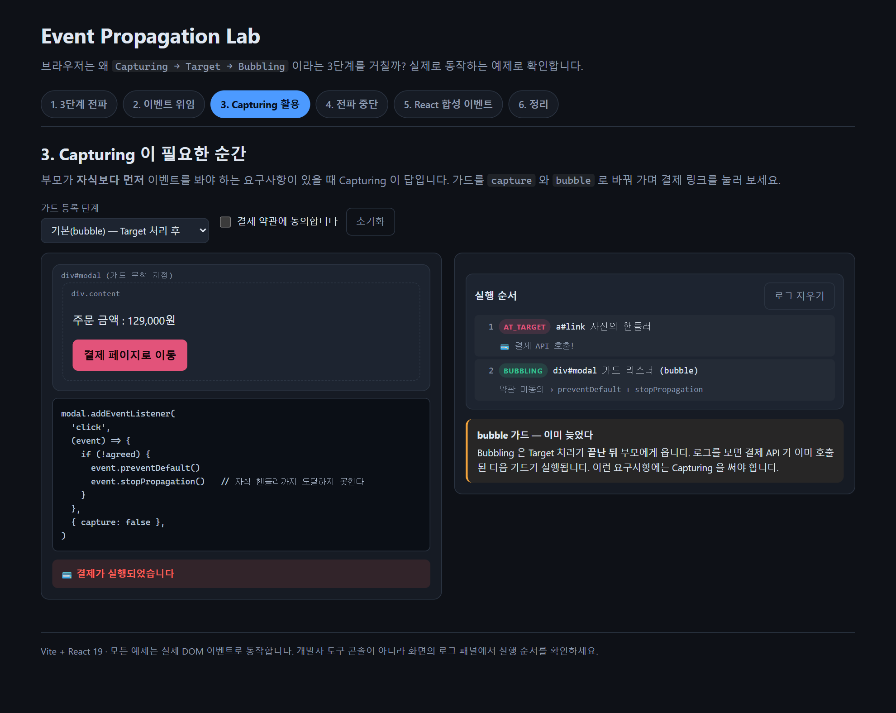
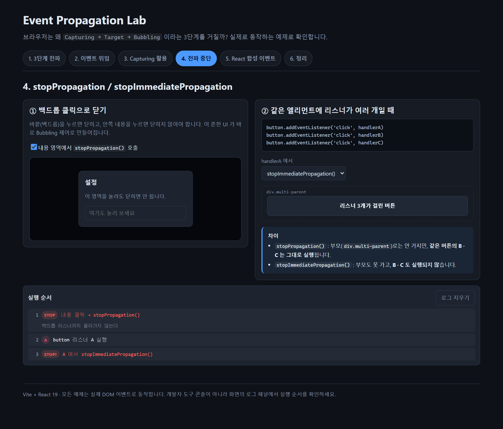
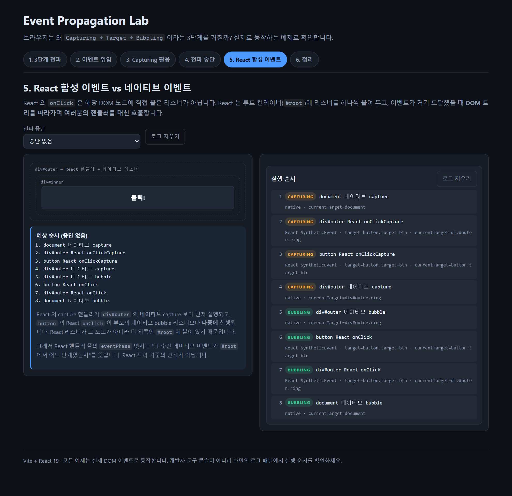
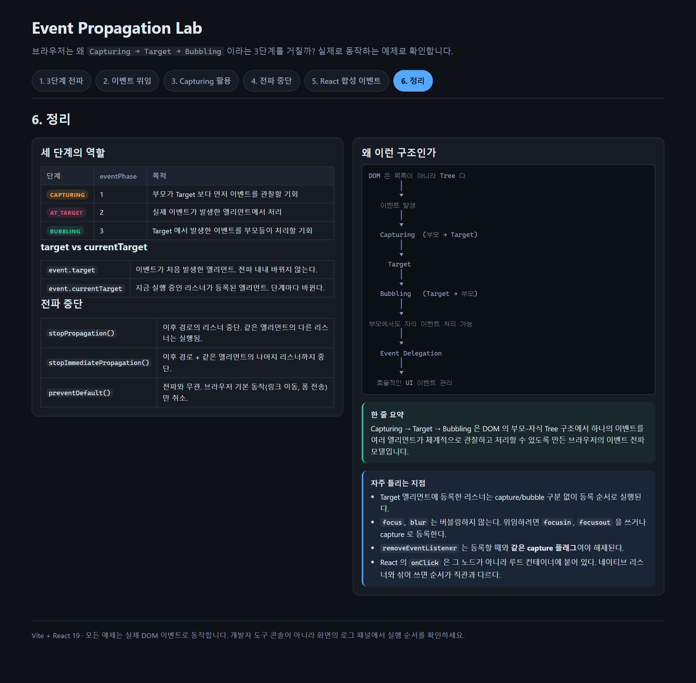

# Event Propagation Lab

브라우저의 `Capturing → Target → Bubbling` 3단계 이벤트 전파를 **직접 눌러 보면서** 이해하는
Vite + React 19 (JavaScript) 샘플입니다.

```bash
npm install
npm run dev
```

## 이 예제의 원칙

- 모든 데모는 **실제 DOM 이벤트**로 동작합니다. 설명용 애니메이션이 아니라
  `addEventListener` 가 실행된 순서를 그대로 기록해서 보여 줍니다.
- 콘솔이 아니라 화면의 **로그 패널**에 실행 순서가 남습니다.
- 각 로그 줄에는 `event.target`, `event.currentTarget`, `event.eventPhase` 가 함께 찍힙니다.

---

## 1. Capturing → Target → Bubbling

`window → document → body → div#app → div#box → button#btn` 여섯 계층에
capture / bubble 리스너 12개를 걸어 두고, 클릭 한 번의 실행 순서를 한 줄씩 재생합니다.
계층별 리스너를 체크박스로 끄거나, 원하는 지점에서 `stopPropagation()` 을 호출해 볼 수 있습니다.



로그 **6·7번**을 보세요. `button#btn` 에 capture 로 등록한 리스너도, bubble 로 등록한 리스너도
둘 다 `AT_TARGET (eventPhase=2)` 로 찍힙니다. **Target 에서는 캡처/버블 구분이 없고 등록 순서대로
실행된다**는 사실이 로그에 그대로 드러납니다. 그리고 12줄 내내 `target=button#btn` 은 바뀌지 않고
`currentTarget` 만 바뀝니다.

> `div#box` 의 여백(버튼 바깥)을 클릭하면 `event.target` 이 `div#box` 로 바뀌고,
> `button#btn` 리스너는 아예 실행되지 않습니다. 직접 눌러서 비교해 보세요.

---

## 2. Bubbling 활용 — Event Delegation

같은 목록을 `li` 마다 리스너를 다는 방식(①)과 부모 `ul` 에 하나만 다는 위임 방식(②)으로
동시에 만들어 두고 비교합니다.



**항목 추가**를 누르면 차이가 드러납니다. ① 쪽의 회색 항목(`Spring Boot`, `Node.js`)은 마운트
이후에 생긴 `li` 라서 리스너가 없고, 클릭해도 아무 반응이 없습니다. ② 쪽은 리스너가 여전히
**1개**뿐인데도 새 항목이 그대로 동작합니다. 자식에서 시작된 클릭이 Bubbling 으로 부모까지
올라오고, 부모는 `event.target` 으로 어떤 자식이었는지 알아내기 때문입니다.

---

## 3. Capturing 이 필요한 순간

결제 링크가 들어 있는 모달입니다. 약관에 동의하지 않았다면 부모가 **자식보다 먼저** 클릭을
가로채야 합니다.

**`{ capture: true }` — 제때 막았다**



가드 리스너 하나만 실행되고 끝납니다. 링크 자신의 핸들러는 아예 호출되지 않아 **결제 미실행**
상태 그대로입니다.

**기본(bubble) — 이미 늦었다**



같은 가드를 bubble 로 등록하면 로그 1번에 이미 `결제 API 호출!` 이 찍힌 뒤 2번에서 가드가
실행됩니다. Bubbling 은 Target 처리가 끝난 다음에 오기 때문입니다. 이런 요구사항에는
Capturing 을 써야 한다는 것이 이 두 장의 차이입니다.

---

## 4. stopPropagation / stopImmediatePropagation



- **① 백드롭 클릭으로 닫기** — 바깥을 누르면 닫히고 안쪽을 누르면 닫히지 않는 흔한 UI 가,
  사실은 내용 영역에서 `stopPropagation()` 을 호출해 Bubbling 을 끊는 것입니다.
  체크박스를 끄고 안쪽을 눌러 보면 그대로 닫힙니다.
- **② 같은 엘리먼트에 리스너 3개** — `handlerA` 에서 `stopImmediatePropagation()` 을 호출하면
  로그가 `A → STOP!` 에서 끊깁니다. B · C 도, 부모도 실행되지 않습니다.
  `stopPropagation()` 으로 바꾸면 B · C 는 실행되고 부모만 막힙니다.

---

## 5. React 합성 이벤트 vs 네이티브 이벤트

React 17 부터 React 는 리스너를 각 DOM 노드가 아니라 **루트 컨테이너(`#root`)** 에
capture / bubble 두 개로 붙입니다. 그래서 네이티브 리스너와 섞이면 순서가 직관과 달라집니다.



왼쪽의 "예상 순서" 와 오른쪽의 실제 로그가 정확히 일치합니다. 핵심은 두 가지입니다.

- `div#outer` 의 **React** `onClickCapture`(2번)가 같은 노드의 **네이티브** capture(4번)보다 먼저.
- `button` 의 React `onClick`(6번)이 부모의 네이티브 bubble(5번)보다 **나중에**.

`전파 중단` 을 `div#outer 의 네이티브 bubble 리스너에서` 로 바꾸면 이벤트가 `#root` 에 도달하지
못해 **React 핸들러가 하나도 실행되지 않습니다.** 서드파티 스크립트 때문에 React 이벤트가
"안 먹는" 전형적인 원인입니다.

---

## 6. 정리



단계별 역할, `target` vs `currentTarget`, 중단 API 비교, 그리고 자주 틀리는 지점을 모았습니다.

---

## 구조

```
src/
  App.jsx                  탭 셸
  index.css                전체 스타일
  components/
    LogPanel.jsx           실행 순서 로그 패널 (공용)
    Note.jsx               설명 박스
  hooks/
    useEventLog.js         리스너 실행 순서 기록 훅
  lib/
    eventUtils.js          eventPhase 이름, 노드 → 셀렉터 문자열
  labs/
    PropagationLab.jsx     1. 3단계 전파
    DelegationLab.jsx      2. 이벤트 위임
    CaptureGuardLab.jsx    3. Capturing 활용
    StopPropagationLab.jsx 4. 전파 중단
    ReactEventLab.jsx      5. React 합성 이벤트
    CheatSheet.jsx         6. 정리
docs/                      README 용 스크린샷
```
